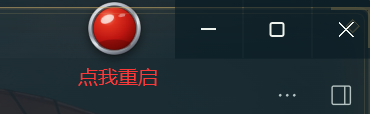

# 重启按钮

  

Windows 桌面端的标题栏右侧多一枚红按钮，就在最小化左边那块空位。点一下，整台 DSH 退出，然后自己重新打开。

## 安装

这是 **1.0.0**，只从 GitHub 安装，没有发布到 npm。

1. DSH 桌面端进插件页，点 Add plugin。
2. 粘贴仓库地址，或者下载 Release 里的 `.tgz`，把它的绝对路径填进去。
3. 点 **Install**，装好之后点 **Enable now**。

只在 Windows 桌面端出现；用浏览器打开 `dsh web` 时这枚按钮不渲染。

## 它做什么

点击之后依次发生：

1. 一段脱离出去的 Node 助手被拉起。它用的是 DSH 自己那个可执行文件，以 Node 模式跑，不经过 PowerShell，也不依赖 PATH。
2. 它把当时开着的所有应用进程结束掉，再单独结束 Host 进程。
3. 等进程退干净、本地端口和单实例锁松开（约一两秒）。
4. 用同一个可执行文件把应用重新打开；没起来就再试，最多三次。

整个过程不需要手动关窗口，也不用重新登录。几秒后窗口回来，还是同一个配置文件、同一份会话记录。

## 用起来是什么样

- 按钮是俯视看的一枚红色圆钮，嵌在一圈窄的亮银色金属座里，没有字。顶面鼓起来，一大一小两点高光；按下去往下沉一点、缩一点，金属座不动。
- 点完之后它会一明一暗地呼吸，表示正在走。
- 窗口消失的这几秒里，按钮自然也一起没了，这是正常的。
- 等它自己回来就行，不用去任务管理器里找。

## 边界

- **会强杀进程。** 点击那一刻正在跑的对话轮次会断，进行中的长任务不会等人，别的会话一起断。会话记录是逐条落盘的，正常情况下不丢，但写入正到一半时被掐掉的极端情形不保证。
- **需要先有一个会话。** 按钮走的是会话命令通道，没有打开的会话就点不动，只会提示一句。
- **误触就等于一次重启。** 它挨着最小化的位置，刻意没加二次确认。
- **不写 profile。** 它不改插件配置、不动配置目录，只在点了之后动作一次。
- **失败会说出来。** 命令没送达、宿主认不出桌面环境、助手起不来，按钮会直接显示原因，而不是假装成功。
- **每一步都留痕。** 命令有没有进来、助手有没有起来、新进程有没有回来，都写在 `%TEMP%\dsh-restart-button.log` 里。

## 命令

除了按钮，`/dsh-restart` 是同一个动作。在输入框里敲它和点按钮等价。
